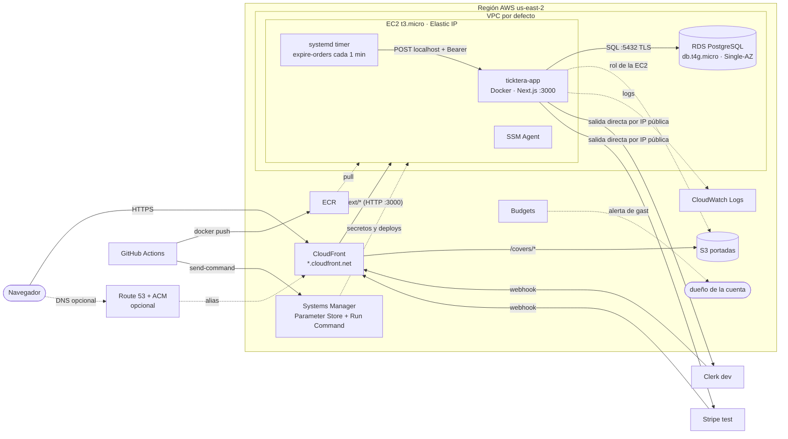

# Despliegue demo en AWS

Arquitectura de Ticktera en AWS para la etapa **demo**: qué servicios se usan, cómo se conectan, cuánto cuestan, qué hay que cambiar en el código y cómo se despliega con GitHub Actions. Diagrama con logos: artifact "Ticktera en AWS". El resto de la arquitectura (auth, pagos, modelo) sigue en [`system-design.md`](./system-design.md) y [`mer.md`](./mer.md).

**Estado:** borrador para aprobar. **Reemplaza** lo que `system-design.md` dice de producción sobre Cloud Run, Cloud SQL, Cloud Scheduler (token OIDC de Google), Secret Manager y Cloud Build. Local no cambia (Neon, Stripe CLI, `.env.local`).

## 1. Alcance y restricciones

| Restricción | Consecuencia en el diseño |
| ----------- | ------------------------- |
| Es una demo, no sale a producción real | Credenciales de sandbox: Clerk `development`, Stripe modo test (`sk_test_`, `pk_test_`). Sin alta disponibilidad. |
| **Crédito de USD 100** y capa gratuita | Todo se elige por costo. Sin NAT Gateway (≈ USD 33/mes), sin balanceador (≈ USD 20), sin WAF (≈ USD 10), sin Multi-AZ. |
| Sin correos en esta etapa | No se usa SES. Queda como el supuesto A6 de `system-design.md`. |
| Todavía no hay dominio | HTTPS sale del dominio gratuito de CloudFront (`dxxxx.cloudfront.net`). Route 53 y ACM son opcionales. |
| CI/CD al actualizar `main` | GitHub Actions: CI en cada push y PR; deploy solo en `main`. |

Lo que no se hace ahora y por qué: ver §10 (camino a producción real).

### Hallazgos de la cuenta (verificados con AWS CLI)

- La cuenta está en el plan FREE con USD 100 de crédito, que vence el 2027-04-15.
- Pertenece a una organización con una SCP que niega todo fuera de **us-east-2 (Ohio)**: toda la infra va ahí. Como consecuencia, ACM en us-east-1 (necesario para un dominio propio en CloudFront) no está disponible.
- La SCP también niega el proveedor OIDC de IAM (ver §6). Sí se pueden crear roles y perfiles de instancia.
- La VPC por defecto de us-east-2 existe (`vpc-0ef0d6c5d023c8bf9`, subredes en 2a, 2b y 2c) y `t3.micro` está permitido.

## Estado actual (desplegado el 2026-10-22)

La app corre en **https://d2tr2lcud9jcsr.cloudfront.net**. Todo en us-east-2, etiquetado `project=ticktera`.

| Recurso | Identificador |
| ------- | ------------- |
| EC2 | `i-08f0198418809d902` (t3.micro, Elastic IP `18.218.96.229`) |
| RDS | `ticktera-db`, PostgreSQL 18.6 (la misma versión mayor que Neon) |
| CloudFront | `E1X9QUV7JCKSF7`, OAC `E2LM5324D5XBXM` |
| S3 | `ticktera-covers-014663857019` |
| ECR | `ticktera-app` (conserva las últimas 6 imágenes) |
| Grupos de seguridad | `sg-0cdfedeccdb8a2568` (app, :3000 solo desde CloudFront), `sg-02c517097d2bea7dc` (db, :5432 solo desde la app) |
| IAM | Rol e instance profile `ticktera-ec2`; usuario `ticktera-ci` |
| Parameter Store | `/ticktera/*` (13 parámetros, incluidos `STRIPE_WEBHOOK_SECRET` y `CLERK_WEBHOOK_SIGNING_SECRET`) |
| Logs | `/ticktera/app` (14 días) |
| Budgets | `ticktera-monthly`, USD 30/mes, alertas al 80 % y 100 % (real) y 100 % (pronóstico) |

Bootstrap de la EC2: `infra/aws/user-data.sh`. Deploy: `infra/aws/deploy.sh`. Pipeline: `.github/workflows/ci-cd.yml`.

**Para cargar un secreto nuevo** (por ejemplo el `whsec_` de Stripe): crear el parámetro y relanzar el deploy.

```bash
aws ssm put-parameter --profile ticketera --region us-east-2 --name /ticktera/STRIPE_WEBHOOK_SECRET --type SecureString --overwrite --value 'whsec_...'
gh workflow run ci-cd -R leandro291/ticktera-app   # el deploy relee Parameter Store y reinicia la app
```

**Webhooks (modo test, configurados y verificados):**
- Stripe: `https://d2tr2lcud9jcsr.cloudfront.net/api/webhooks/stripe`, evento `payment_intent.succeeded`.
- Clerk (instancia development): `https://d2tr2lcud9jcsr.cloudfront.net/api/webhooks/clerk`, eventos `user.created`, `user.updated` y `user.deleted`.

**Datos de ejemplo:** el seed se corrió en RDS (8 categorías, 8 eventos, 38 tipos de entrada; omite los eventos en EUR/USD). Para repetirlo se usa la imagen `migrate` en la EC2 vía SSM, porque `db:seed` se niega a correr con `NODE_ENV=production`; el usuario organizador debe existir antes en `users`.

## 2. Arquitectura



### Qué entra por dónde

| Origen | Destino | Camino | Autenticación |
| ------ | ------- | ------ | ------------- |
| Navegador | App | CloudFront → EC2 :3000 | Sesión de Clerk |
| Navegador | Portadas | CloudFront → S3 (OAC) | Pública (lectura) |
| Stripe | `POST /api/webhooks/stripe` | CloudFront → EC2 | Firma del webhook |
| Clerk | `POST /api/webhooks/clerk` | CloudFront → EC2 | Firma (`verifyWebhook`) |
| Timer de la EC2 | `POST localhost:3000/api/internal/expire-orders` | Local, no sale de la instancia | `Authorization: Bearer` (`INTERNAL_JOB_SECRET`) |
| App | Stripe, Clerk | EC2 → internet por su IP pública | Claves secretas |
| App | RDS | Misma VPC, puerto 5432 con TLS | Usuario y contraseña |
| App | S3 | Rol de la EC2 (`PutObject`, `DeleteObject` sobre `covers/*`) | IAM |
| GitHub Actions | ECR, EC2 | `docker push` y Run Command | Usuario IAM `ticktera-ci` (clave en secretos del repo) |

## 3. Servicios y costo

Precios de lista de us-east-1 (us-east-2 cuesta lo mismo en estos servicios), orden de magnitud. **Confirmar en Billing el plan de la cuenta y el saldo del crédito**: las cuentas nuevas tienen un plan gratuito con crédito y restricciones de servicios y tamaños de instancia; las cuentas con el free tier clásico de 12 meses tienen t3.micro y RDS micro gratis. Con t3.micro y db.t4g.micro se cumplen los límites de instancias que suelen permitir esos planes.

| Servicio | Para qué | Configuración | USD / mes |
| -------- | -------- | ------------- | --------- |
| CloudFront | Entrada única, HTTPS, caché y portadas | Dominio `*.cloudfront.net`; free tier de 1 TB y 10 M de peticiones | ≈ 0 |
| EC2 | App en Docker + timer de vencimiento | t3.micro (1 GB), AL2023, 20 GB gp3 | ≈ 9 |
| Elastic IP | IP fija para el origen de CloudFront | IPv4 pública (se cobra por hora) | ≈ 3,7 |
| RDS PostgreSQL | Base de datos | db.t4g.micro Single-AZ, 20 GB gp3, backups 1 día | ≈ 14 |
| S3 | Portadas de eventos | Bucket privado, cifrado | < 1 |
| ECR | Imagen Docker | Conservar las últimas 3 imágenes | < 1 |
| Systems Manager | Secretos (Parameter Store) y deploys (Run Command) | Parámetros estándar | 0 |
| CloudWatch Logs | Logs de la app | Retención 14 días (5 GB de ingesta gratis) | ≈ 0 |
| IAM | Roles | Mínimo privilegio | 0 |
| Budgets | Alerta de gasto | 2 presupuestos gratis | 0 |
| Route 53 (opcional) | DNS | 1 zona, más el dominio si se compra | 0,50 |
| ACM (opcional) | Certificado del dominio propio | us-east-1 | 0 |
| **Total** | | EC2 y RDS encendidos 24/7 | **≈ 27** |

### Cuánto dura el crédito

| Escenario | USD / mes | Duración de USD 100 |
| --------- | --------- | ------------------- |
| Propuesta, 24/7 | ≈ 27 | ≈ 3,7 meses |
| EC2 y RDS detenidos 12 h al día | ≈ 17 | ≈ 6 meses |
| Postgres en la EC2 (sin RDS), 24/7 | ≈ 13 | ≈ 7,5 meses |
| Cuenta con free tier clásico de 12 meses | ≈ 0–5 | n/a |

Medidas para cuidar el crédito:

- **AWS Budgets**: presupuesto mensual de USD 30 sobre el gasto bruto, con alertas al 80 % y al 100 %. Esto envía un aviso a la cuenta de AWS; no es un correo de la aplicación.
- Detener EC2 y RDS cuando no haya demo. Una instancia detenida no cobra cómputo (sí EBS y la IP). RDS detenido se reinicia solo a los 7 días: volver a detenerlo.
- Sin NAT, sin balanceador, sin Multi-AZ, sin Performance Insights, sin RDS Proxy.
- Revisar **Cost Explorer** una vez por semana las primeras semanas.

## 4. Red y seguridad

Se usa la **VPC por defecto** (YAGNI para una demo): la EC2 en una subred pública con Elastic IP, y RDS en la misma VPC con `PubliclyAccessible=false`. La EC2 sale a internet por su propia IP, por eso no hace falta NAT.

| Grupo de seguridad | Entrada permitida |
| ------------------ | ----------------- |
| `sg-app` (EC2) | TCP 3000 solo desde la prefix list `com.amazonaws.global.cloudfront.origin-facing`. **Sin puerto 22**: el acceso es por Session Manager. |
| `sg-db` (RDS) | TCP 5432 solo desde `sg-app` |

- La prefix list de CloudFront ocupa ≈ 55 de las 60 reglas por defecto de un grupo: dejar `sg-app` solo para eso.
- La prefix list admite a cualquier distribución de CloudFront, no solo a la propia. Aceptable en una demo con datos de prueba. El endurecimiento es un header secreto `X-Origin-Verify` que CloudFront agrega y `proxy.ts` valida.
- El tráfico CloudFront → EC2 va por HTTP dentro de la red de AWS. Para HTTPS de punta a punta haría falta un certificado en la EC2, que con un dominio propio se resuelve más adelante.
- RDS: cifrado en reposo, `rds.force_ssl=1` (valor por defecto en PostgreSQL 15+), backups 1 día (el plan gratuito no permite más) y `deletion_protection` desactivado para poder limpiar al terminar la demo. La app conecta con TLS verificado: incluir `global-bundle.pem` (certificados de RDS) en la imagen, `NODE_EXTRA_CA_CERTS` apuntando a él y `?sslmode=verify-full` en `DATABASE_URL`.

### IAM

| Rol | Quién lo usa | Permisos |
| --- | ------------ | -------- |
| Perfil de instancia de la EC2 | La EC2 y la app | `AmazonSSMManagedInstanceCore`; leer ECR (`ecr:GetAuthorizationToken`, `BatchGetImage`, `GetDownloadUrlForLayer`); leer `ssm:GetParametersByPath` sobre `/ticktera/*` y `kms:Decrypt` de la clave por defecto de SSM; escribir en el grupo de logs; `s3:PutObject` y `s3:DeleteObject` sobre `covers/*` |
| Despliegue (usuario `ticktera-ci`) | GitHub Actions | Subir a ECR; `ssm:SendCommand` solo sobre la instancia y el documento `AWS-RunShellScript`; `ssm:GetCommandInvocation` |

Sin usuarios IAM con llaves. El rol de despliegue confía solo en el repo y en `ref:refs/heads/main`.

### Secretos y variables

Los secretos viven en **Systems Manager Parameter Store** (tipo `SecureString`, nivel estándar, gratis) bajo `/ticktera/`. El script de deploy los lee con el rol de la EC2 y los escribe en un `.env` con permisos `600`, que se pasa al contenedor con `--env-file`. Es la alternativa gratuita a Secrets Manager (≈ USD 0,40 por secreto al mes).

| Variable | Dónde | Notas |
| -------- | ----- | ----- |
| `DATABASE_URL` | Parameter Store | Endpoint de RDS, `sslmode=verify-full` |
| `CLERK_SECRET_KEY`, `CLERK_WEBHOOK_SIGNING_SECRET` | Parameter Store | Instancia `development` |
| `STRIPE_SECRET_KEY`, `STRIPE_WEBHOOK_SECRET` | Parameter Store | Modo test; el `whsec_` es el del endpoint creado en el dashboard de Stripe, no el de Stripe CLI |
| `INTERNAL_JOB_SECRET` | Parameter Store | Mínimo 32 caracteres; lo usa el timer local |
| `SUPER_ADMIN_EMAIL` | Parameter Store | |
| `COVERS_BUCKET`, `COVERS_PUBLIC_BASE_URL` | Parameter Store | Nuevas; reemplazan a `BLOB_READ_WRITE_TOKEN`. La segunda es `https://dxxxx.cloudfront.net` |
| `NODE_EXTRA_CA_CERTS` | Imagen | Ruta al bundle de RDS |
| `NEXT_PUBLIC_CLERK_PUBLISHABLE_KEY`, `NEXT_PUBLIC_STRIPE_PUBLISHABLE_KEY` | `--build-arg` (variables del repo en GitHub) | Se incrustan al compilar; son claves públicas |
| `NEXT_PUBLIC_GOOGLE_MAPS_API_KEY` | No se define | Maps queda apagado (se enciende por presencia de la key) |
| `EXPIRE_ORDERS_AUDIENCE`, `EXPIRE_ORDERS_SERVICE_ACCOUNT` | No se usan | Eran del token OIDC de Google |

## 5. Configuración por servicio

### 5.1 CloudFront

Una distribución con dos orígenes y el certificado por defecto (`*.cloudfront.net`, HTTPS gratis):

- **EC2**: nombre DNS público de la Elastic IP (`ec2-x-x-x-x.compute-1.amazonaws.com`), protocolo HTTP, puerto 3000.
- **S3** con Origin Access Control.

| Ruta | Origen | Caché | Política de origen |
| ---- | ------ | ----- | ------------------ |
| `/_next/static/*` | EC2 | CachingOptimized (archivos con hash, inmutables) | Mínima |
| `/_next/image*` | EC2 | Política propia: clave con todos los query strings; respeta `Cache-Control` | Mínima |
| `/covers/*` | S3 | CachingOptimized (nombres aleatorios) | n/a |
| `*` (por defecto) | EC2 | CachingDisabled | AllViewer (reenvía `Host`, cookies y headers) |

Reenviar `Host` y cookies en la ruta por defecto es obligatorio: Clerk lee la sesión de las cookies y las Server Actions de Next comparan `Origin` con `Host`. Redirigir HTTP a HTTPS y permitir todos los métodos. Con ese dominio se configuran los webhooks de Clerk y Stripe.

**Dominio propio (opcional):** agregar el dominio como *alternate domain name*, pedir un certificado en ACM (us-east-1, gratis) y crear el alias en Route 53. El dominio `cloudfront.net` sigue funcionando, así que las URLs de portadas ya guardadas no se rompen. Hay que sumar el dominio nuevo a `images.remotePatterns` si las portadas se sirven desde él.

### 5.2 EC2

- t3.micro (1 GB), Amazon Linux 2023, disco gp3 de 20 GB, Elastic IP, perfil de instancia del §4. Sin par de llaves SSH.
- **Swap de 2 GB**: 1 GB de RAM alcanza para Next.js `standalone`, pero no tiene margen para el optimizador de imágenes. Si aun así se queda corta, pasar a t3.small (+ ≈ USD 7,6).
- Bootstrap por *user data*: instalar `docker` y `jq`, habilitar Docker, crear `/opt/ticktera`, el swap, el script de deploy y el timer.
- El contenedor corre con `--restart unless-stopped` y el driver de logs `awslogs` hacia CloudWatch (retención 14 días).
- Un solo contenedor de la app: cada deploy tiene un corte de unos segundos. Aceptable en una demo.

**Timer de vencimiento** (reemplaza a Cloud Scheduler y no cuesta nada): una unidad `systemd` que cada minuto ejecuta

```bash
curl -fsS -m 30 -X POST \
  -H "Authorization: Bearer $INTERNAL_JOB_SECRET" \
  http://localhost:3000/api/internal/expire-orders
```

Usa el modo secreto que `expire-orders` ya tiene implementado; no hay cambios de código ni límites de timeout, y el tráfico no sale de la instancia. `FOR UPDATE SKIP LOCKED` evita que dos corridas procesen la misma orden.

### 5.3 RDS

- db.t4g.micro, PostgreSQL con **la misma versión mayor que Neon**, Single-AZ, gp3 de 20 GB, backups automáticos 1 día, sin Performance Insights, sin acceso público.
- Pool de `pg` por defecto (10 conexiones): sobra para una instancia.
- **Alternativa sin RDS:** Postgres en un contenedor con volumen EBS en la misma EC2 (≈ USD 14 menos al mes). Pierde backups automáticos, aísla peor la memoria de un equipo de 1 GB y exige un respaldo manual (`pg_dump` a S3). Solo si el crédito apremia.

### 5.4 S3 (portadas)

- Bucket privado con bloqueo de acceso público y cifrado por defecto; lectura solo para esta distribución de CloudFront (OAC).
- La app sube con el rol de la EC2. El objeto conserva el nombre aleatorio y la base guarda la URL `https://<dominio de CloudFront>/covers/<nombre>`.
- Se mantienen los controles actuales: MIME, magic bytes, tamaño ≤ 2 MiB y rechazo de `Sec-Fetch-Site: cross-site`.

### 5.5 ECR y logs

- Repositorio `ticktera-app` con escaneo al subir y una política de ciclo de vida que conserva las últimas 3 imágenes (un tag `app-<sha>` y otro `migrate-<sha>` por commit).
- Logs: grupo `/ticktera/app` con retención de 14 días. La app ya escribe `console.info` y `console.error` (incluido el log de auditoría `event.audit`). Con los 5 GB gratis de ingesta mensual alcanza.

## 6. CI/CD con GitHub Actions

Se dispara en cada push a `main` y en pull requests (los PR solo corren CI).

```text
push a main
  → job ci: npm ci, lint, tsc --noEmit, vitest run
  → job deploy (needs: ci, solo main)
      · usa la clave del usuario IAM `ticktera-ci` (la SCP bloquea OIDC)
      · docker buildx build: target runner → :app-<sha>, target migrate → :migrate-<sha>, push a ECR
      · ssm send-command a la EC2 → /opt/ticktera/deploy.sh <sha>
      · espera el resultado; si el script falla, el job falla
```

**Secretos y variables del repositorio** (Settings → Secrets and variables → Actions):

| Nombre | Tipo | Valor |
| ------ | ---- | ----- |
| `AWS_ACCESS_KEY_ID`, `AWS_SECRET_ACCESS_KEY` | Secret | Clave del usuario `ticktera-ci` |
| `AWS_REGION` | Variable | `us-east-2` |
| `EC2_INSTANCE_ID` | Variable | ID de la instancia |
| `ECR_REPOSITORY` | Variable | `ticktera-app` |
| `NEXT_PUBLIC_CLERK_PUBLISHABLE_KEY`, `NEXT_PUBLIC_STRIPE_PUBLISHABLE_KEY` | Variables | Claves públicas de sandbox |

**Archivos en el repo** (fuente de verdad, no se duplican acá):

| Archivo | Qué hace |
| ------- | -------- |
| `.github/workflows/ci-cd.yml` | Job `ci` (lint, tsc, vitest) y job `deploy` solo en `main` |
| `Dockerfile` | Targets `migrate` y `runner` (por defecto) |
| `infra/aws/deploy.sh` | Script que corre en la EC2: pull, migraciones, reemplazo de la app, health check y vuelta atrás. El workflow lo envía dentro del comando de SSM, así la EC2 no necesita clonar el repo |

**Autenticación de GitHub hacia AWS.** La SCP de la organización de la cuenta niega la creación del proveedor OIDC de GitHub, así que el workflow usa un **usuario IAM dedicado** (`ticktera-ci`) con clave de acceso guardada en secretos del repo. Su política se limita a: subir imágenes al repositorio ECR `ticktera-app` y ejecutar `ssm:SendCommand` sobre la instancia y el documento `AWS-RunShellScript`. Cuando se termine la demo, se elimina el usuario. El repo es público: nada de esto va en el código, solo en secretos y variables de GitHub.

Notas:

- Migraciones **compatibles hacia atrás** (agregar antes de quitar): si la app nueva falla el health check, vuelve la imagen anterior sobre el esquema ya migrado.
- Dos targets de Docker: `runner` (solo el build `standalone`, usuario no root) y `migrate` (con `drizzle-kit`, que es dependencia de desarrollo y no está en la imagen final).
- Primer arranque: el rol de despliegue y la EC2 se crean a mano (o con IaC) antes de que el workflow pueda correr; hasta entonces **no agregar el workflow a `main`**, porque quedaría en rojo.
- Cargar datos de demo con la imagen de migraciones: `docker run --rm --env-file .env -e NODE_ENV=development $REPO:migrate-$SHA npm run db:seed -- --organizer <email>` (`db:seed` se niega a correr con `NODE_ENV=production`, y el organizador debe existir antes en Clerk y en `users`).

## 7. Cambios en el código

Ninguno se hace en esta tarea; cada uno es trabajo de la fase correspondiente (§8) y pasa por spec.

| Cambio | Archivo | Detalle |
| ------ | ------- | ------- |
| Salida `standalone` | `next.config.ts` | `output: "standalone"` |
| Dominio de imágenes | `next.config.ts` | Reemplazar `*.public.blob.vercel-storage.com` por `*.cloudfront.net`. Las portadas se guardan como URL absoluta: una ruta relativa `/covers/…` no serviría, porque el optimizador de `next/image` la pediría a la propia app, que no las sirve |
| Dockerfile | raíz | Multi-stage con targets `runner` y `migrate`, usuario no root, `HOSTNAME=0.0.0.0`, `PORT=3000`, bundle de RDS. Agregar `.dockerignore` |
| Health check | `app/api/health/route.ts` | Responde 200 sin tocar la base. Pasa por `clerkMiddleware` (el `matcher` incluye `/api`) pero sin sesión no redirige |
| Portadas a S3 | `modules/event/services/event-cover-service.ts` | `@aws-sdk/client-s3` en lugar de `@vercel/blob`; quitar `@vercel/blob` y `BLOB_READ_WRITE_TOKEN` |
| Variables | `lib/env.ts` | Agregar `COVERS_BUCKET` y `COVERS_PUBLIC_BASE_URL` (opcionales, 503 si faltan, igual que hoy) |
| Job de vencimiento | — | Sin cambios: producción usa el modo secreto. El modo OIDC de Google queda sin uso y puede borrarse después |
| Workflow | `.github/workflows/ci-cd.yml` | El YAML del §6 |
| Documentación | `system-design.md` | Actualizar §1 (tabla local/producción y variables), §3.4 y "Endpoints internos" |

Otros puntos:

- `revalidatePath` solo se usa en el panel de usuarios; con una sola instancia no hay problema de caché compartida.
- Si ya hay portadas en Vercel Blob, copiarlas a S3 y actualizar `events.cover_image_url`. En una demo nueva no hay nada que migrar.
- Webhooks: crear en el dashboard de Stripe (modo test) el endpoint `https://<dominio de CloudFront>/api/webhooks/stripe` y copiar su `whsec_` a Parameter Store; en Clerk (instancia `development`), el endpoint `/api/webhooks/clerk`. Verificar que el login de Clerk funcione desde la URL de CloudFront.

## 8. Plan de implementación

| Fase | Entrega | Verificación |
| ---- | ------- | ------------ |
| 0. Cuenta | Revisar plan y crédito en Billing, crear el presupuesto con alertas, elegir región | Alerta de Budgets recibida en una prueba |
| 1. Base | Grupos de seguridad, RDS, parámetros en Parameter Store, bucket S3, repositorio ECR | Conexión a RDS desde la EC2 y migraciones aplicadas a mano |
| 2. App | Dockerfile, `/api/health`, EC2 con Docker y el timer, primer deploy manual | `curl localhost:3000/api/health` en la EC2 |
| 3. Borde | CloudFront con ambos orígenes y los comportamientos del §5.1; portadas en S3 | Login, subida de portada y `/_next/static` cacheado desde la URL de CloudFront |
| 4. Integraciones | Webhooks de Stripe (test) y Clerk (dev) contra CloudFront | Compra de prueba de punta a punta; una orden vence sola a los 15 min |
| 5. CI/CD | Usuario `ticktera-ci`, secretos del repo, workflow en `main` | Un push a `main` despliega y un push que rompe el health check vuelve atrás |
| 6. Opcional | Route 53 y ACM cuando haya dominio | La app responde en el dominio propio |

Cada fase se puede revertir sola. Conviene desplegar a mano la primera vez (fase 2) y automatizar en la 5, así el workflow se prueba contra algo que ya funciona.

## 9. Riesgos y decisiones abiertas

**Decisiones por confirmar**

- **RDS o Postgres en la EC2.** RDS cuesta ≈ USD 14 al mes y da backups y aislamiento; sin RDS el crédito dura ≈ 7,5 meses en vez de ≈ 3,7. La propuesta usa RDS.
- **Horario de apagado.** Detener EC2 y RDS fuera de horario estira el crédito a ≈ 6 meses. Se puede automatizar con dos reglas de EventBridge Scheduler (gratis), pero no se incluye ahora.
- **Región.** Resuelta: la SCP de la cuenta solo permite us-east-2.
- **Terraform o consola.** Para una demo se puede armar a mano y documentar; con IaC la limpieza al final (evitar cobros residuales) es más segura.

**Riesgos**

- **El crédito se agota antes de lo esperado.** Mitigado con Budgets y la revisión semanal en Cost Explorer. Al terminar la demo, **eliminar** instancia, RDS (con snapshot final si hace falta), Elastic IP y bucket: una IP elástica suelta sigue cobrando.
- **1 GB de RAM.** Si Next.js entra en OOM, el contenedor se reinicia y se nota en los logs. Pasar a t3.small.
- **Una sola instancia.** Sin redundancia: un reinicio o un deploy cortan el servicio unos segundos. Aceptable para una demo.
- **El origen acepta a cualquier distribución de CloudFront.** Mitigable con el header secreto del §4.
- **Cuenta con plan gratuito restringido.** Algunos planes limitan servicios o tamaños de instancia, y el plan termina a los seis meses o al agotarse el crédito. Verificar en Billing.
- **El código del QR sin firma** exige límite de intentos en el check-in (#24). Sin WAF, ese límite debe estar en la propia app.

## 10. Camino a producción real

Si la demo pasa a producción, estos son los cambios en orden de impacto. Cuestan unos USD 300–360 al mes y no hacen falta hoy:

| Hoy (demo) | Producción |
| ---------- | ---------- |
| EC2 única con Docker | ECS Fargate con 2 a 6 tareas en 2 zonas, detrás de un ALB |
| CloudFront sin protección | CloudFront + WAF con reglas gestionadas y límite por IP |
| VPC por defecto, EC2 pública | VPC propia con subredes públicas, privadas y aisladas, y una NAT por zona |
| RDS Single-AZ micro | RDS Multi-AZ `db.t4g.medium`, con alarmas |
| Parameter Store + `.env` | Secrets Manager inyectado en la definición de tarea |
| Timer en la EC2 | Regla de EventBridge con API destination, o una Lambda |
| Deploy con Run Command | ECS rolling con circuit breaker |
| Sin correos | SES (supuesto A6) |
| Credenciales de sandbox | Clerk `production`, Stripe live (requiere la empresa de EE.UU. de `system-design.md`), dominio propio con Route 53 y ACM |

La imagen Docker, el workflow de CI y el modelo de variables se reutilizan tal cual.

---

Íconos de servicios AWS: AWS Architecture Icons. Logos de terceros: Simple Icons (CC0).
